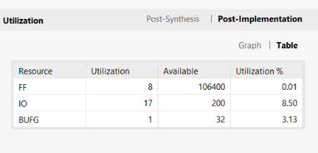
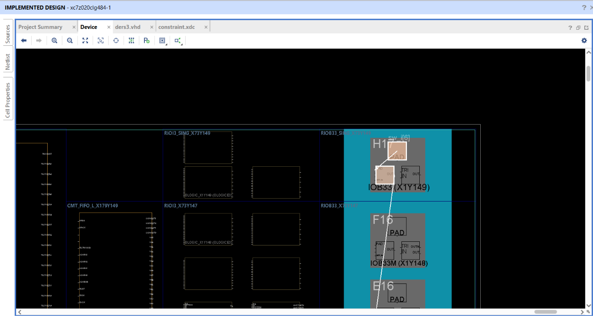
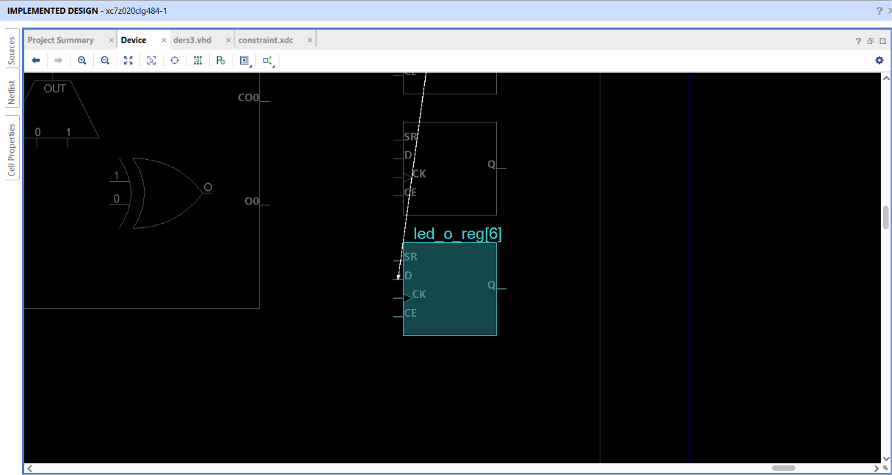
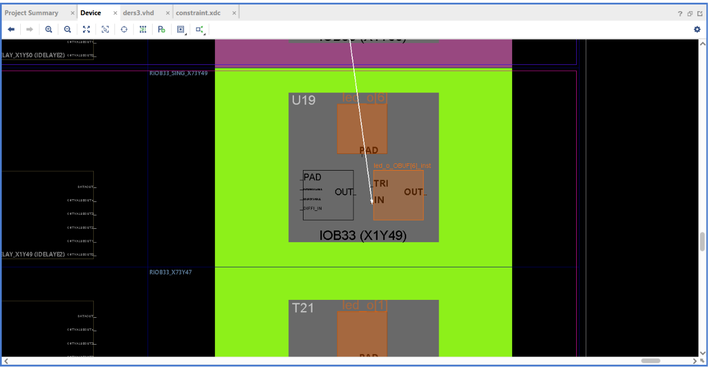
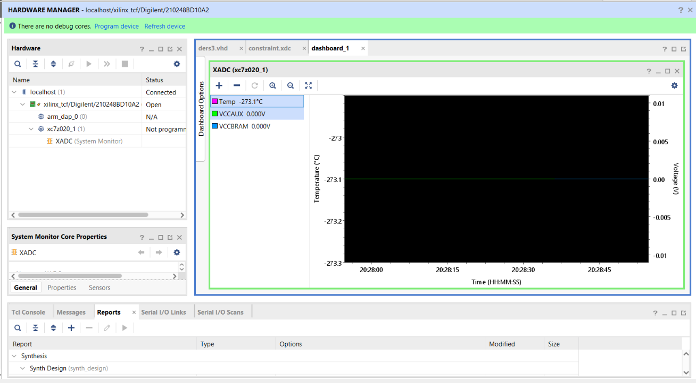
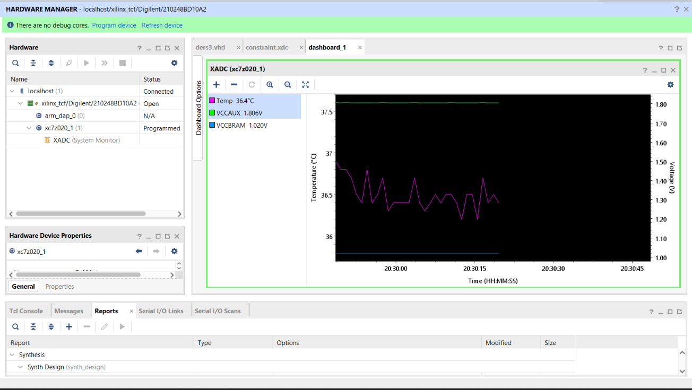

# Lesson 3: Switch to LED

A first design for the programmable logic (PL) of the Zynq. On each rising edge of the 100 MHz clock, the eight user switches are sampled into flip-flops that drive the eight user LEDs. The processing system (PS) is not used.

```text
           +---------------+
sw_i[7:0] -|D             Q|- led_o[7:0]
           |   8-bit FF    |
      clk -|>              |
           +---------------+
```

## Files

| Path | Description |
| --- | --- |
| [src/switch_to_led.vhd](src/switch_to_led.vhd) | VHDL design |
| [constraints/zedboard.xdc](constraints/zedboard.xdc) | ZedBoard pin and timing constraints |
| [scripts/build.tcl](scripts/build.tcl) | Vivado batch build script |
| [bitstream/switch_to_led.bit](bitstream/switch_to_led.bit) | Pre-built bitstream |
| [reports/](reports/) | Timing, utilization, power, DRC, and methodology reports |

## Pin assignments

| Signal | Pin | | Signal | Pin |
| --- | --- | --- | --- | --- |
| `clk` | Y9 | | | |
| `sw_i[0]` | F22 | | `led_o[0]` | T22 |
| `sw_i[1]` | G22 | | `led_o[1]` | T21 |
| `sw_i[2]` | H22 | | `led_o[2]` | U22 |
| `sw_i[3]` | F21 | | `led_o[3]` | U21 |
| `sw_i[4]` | H19 | | `led_o[4]` | V22 |
| `sw_i[5]` | H18 | | `led_o[5]` | W22 |
| `sw_i[6]` | H17 | | `led_o[6]` | U19 |
| `sw_i[7]` | M15 | | `led_o[7]` | U14 |

## Build

Run from this folder with Vivado 2023.2:

```text
vivado -mode batch -source scripts/build.tcl
```

The reports and bitstream are written to `build/`.

## Program the board

1. Set jumper **JP18** to 3.3V. The switches sit on VADJ-powered banks and are constrained as `LVCMOS33`.
2. Connect the micro-USB cable to the **PROG** port (J17), not the UART port (J14).
3. Connect the power adapter and turn on **SW8**.
4. In Vivado, open **Hardware Manager**, then select **Open Target > Auto Connect**.
5. Select **Program Device** and choose the `.bit` file.

## Results

Results for the routed design:

| Metric | Value |
| --- | --- |
| Flip-flops | 8 / 106,400 |
| LUTs | 0 / 53,200 |
| Bonded I/O | 17 / 200 |
| Global clock buffers | 1 / 32 |
| Timing | All user constraints met |
| Methodology violations | 0 |
| Estimated on-chip power | 0.113 W (low confidence) |



No LUTs are needed because the design contains only flip-flops and I/O buffers.

## Implemented design

These views trace `sw_i[6]` through the device.

The signal enters at pin H17:



It reaches the `D` input of the flip-flop `led_o_reg[6]`:



The flip-flop output leaves through the output buffer at pin U19:



## XADC temperature monitoring

The Zynq's on-chip XADC can be read over JTAG from Hardware Manager.

Before programming, the device shows `Not programmed` and every reading is zero. A raw temperature code of zero converts to about -273 °C, so this value is not a real temperature:



After programming, the readings are valid: about 36.4 °C, with VCCAUX at 1.806 V and VCCBRAM at 1.020 V.



## Notes

- **Clock constraint:** The first build had no `create_clock`, so Vivado did not analyze timing, reported eight `TIMING-17` critical warnings, and gave an unrealistic power estimate of 6.48 W. Adding the 100 MHz constraint fixed all three.
- **False paths:** Switches and LEDs are asynchronous to `clk`, so their I/O paths are excluded from timing analysis. Vivado still lists them under `no_input_delay` and `no_output_delay`, which is expected here.
- **`ZPS7-1` warning:** Vivado warns that the design has no PS7 block. It is expected for this PL-only design, and later PS designs include that block.
- **Metastability:** The switches are sampled by a single flip-flop. That is acceptable for driving LEDs, but a signal feeding other logic should pass through a two-flip-flop synchronizer.
- **Screenshots:** They were captured from the first build, before the entity was renamed and the constraints were updated. The logic and pin assignments are unchanged.
