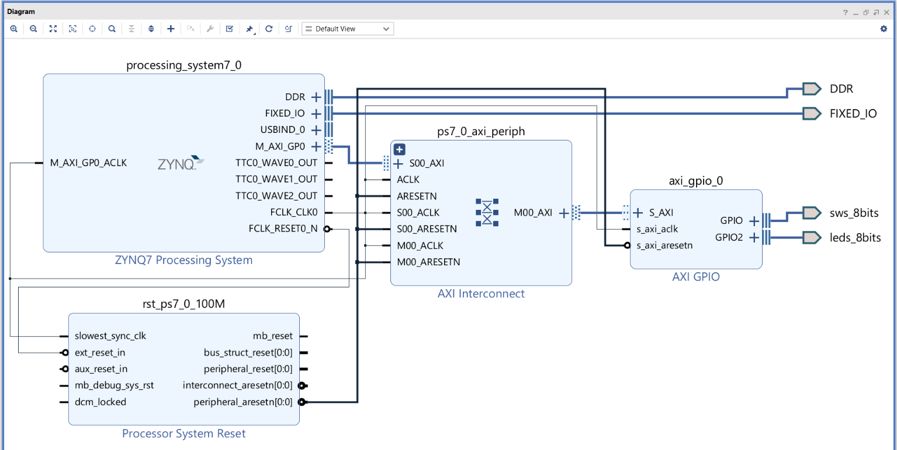
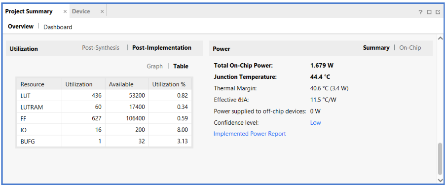
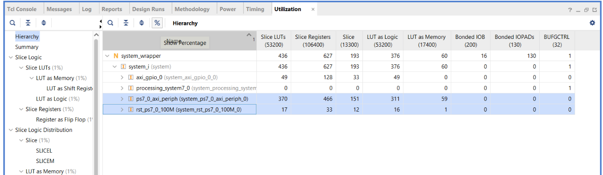
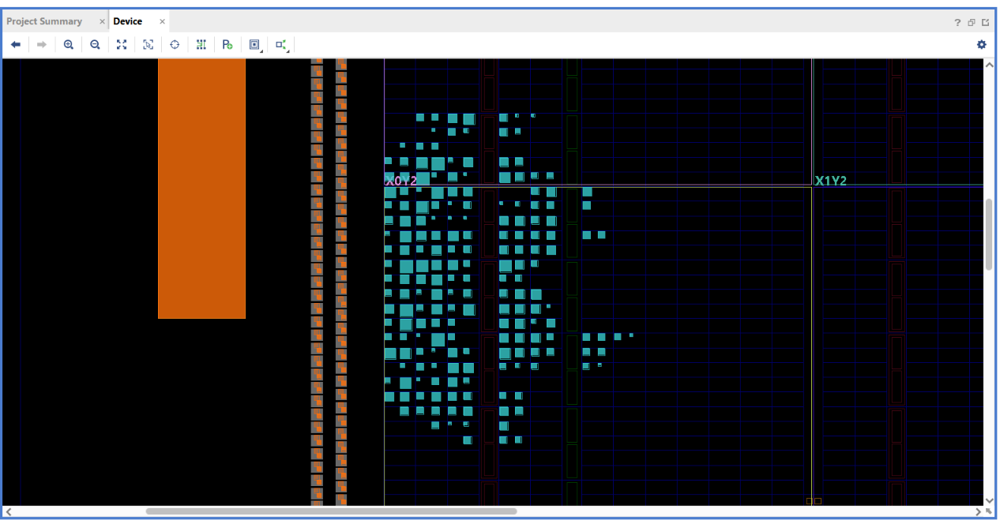

# Lesson 4: AXI GPIO Block Design

The first design that uses both sides of the Zynq. The processing system (PS) reaches the switches and LEDs through an AXI GPIO peripheral in the programmable logic (PL). The hardware is exported as an XSA file for the software side of the design.



## Block design

| Block | Role |
| --- | --- |
| `processing_system7_0` | Zynq PS with the ZedBoard presets. Provides `FCLK_CLK0` (100 MHz), `FCLK_RESET0_N`, and the `M_AXI_GP0` master port |
| `ps7_0_axi_periph` | AXI Interconnect from `M_AXI_GP0` to the peripheral |
| `axi_gpio_0` | Dual-channel GPIO: channel 1 reads the switches, channel 2 drives the LEDs |
| `rst_ps7_0_100M` | Generates synchronized resets for the PL |

The switches and LEDs use the `sws_8bits` and `leds_8bits` board interfaces, so Vivado applies their pins and I/O standards from the ZedBoard board file. The project needs no XDC file.

## Address map

`axi_gpio_0` is mapped at base address `0x41200000` with a 64 KB range.

| Offset | Register | Use in this design |
| --- | --- | --- |
| `0x00` | `GPIO_DATA` | Read the switches |
| `0x04` | `GPIO_TRI` | Direction of channel 1 |
| `0x08` | `GPIO2_DATA` | Write the LEDs |
| `0x0C` | `GPIO2_TRI` | Direction of channel 2 |

## Files

| Path | Description |
| --- | --- |
| [scripts/system_bd.tcl](scripts/system_bd.tcl) | Block design, exported from Vivado |
| [scripts/build.tcl](scripts/build.tcl) | Vivado batch build script |
| [hardware/system_wrapper.xsa](hardware/system_wrapper.xsa) | Hardware platform with the bitstream included |
| [bitstream/system_wrapper.bit](bitstream/system_wrapper.bit) | Pre-built bitstream |
| [reports/](reports/) | Timing, utilization, power, DRC, and methodology reports |

## Build

Install the ZedBoard board files from **Tools > Vivado Store > Boards**, then run from this folder with Vivado 2023.2:

```text
vivado -mode batch -source scripts/build.tcl
```

The reports, bitstream, and XSA are written to `build/`.

## Board setup

Set jumper **JP18** to 2.5V. The board file constrains the switches as `LVCMOS25`, and they sit on VADJ-powered banks.

## Results

Results for the routed design:

| Metric | Value |
| --- | --- |
| LUTs | 436 / 53,200 (0.82%) |
| LUTs as memory | 60 / 17,400 (0.34%) |
| Flip-flops | 627 / 106,400 (0.59%) |
| Bonded I/O | 16 / 200 |
| Global clock buffers | 1 / 32 |
| Setup slack (WNS) | +2.949 ns at 100 MHz |
| Hold slack (WHS) | +0.072 ns |
| DRC violations | 0 |
| Estimated on-chip power | 1.679 W (low confidence) |
| Estimated junction temperature | 44.4 °C |



The AXI Interconnect uses most of the PL logic in this design:



The logic is placed close to the PS, shown in orange on the left:



## Notes

- **Power:** The PS accounts for most of the estimate, which is why it is far higher than the PL-only design in Lesson 3.
- **`TIMING-18` warnings:** Vivado reports 16 methodology warnings for the missing input and output delays on the switch and LED pins. These signals are human-speed, so the warnings do not affect this design.
- **Testing:** This lesson covers the hardware design and XSA export. The design has not yet been run on the board with software.
